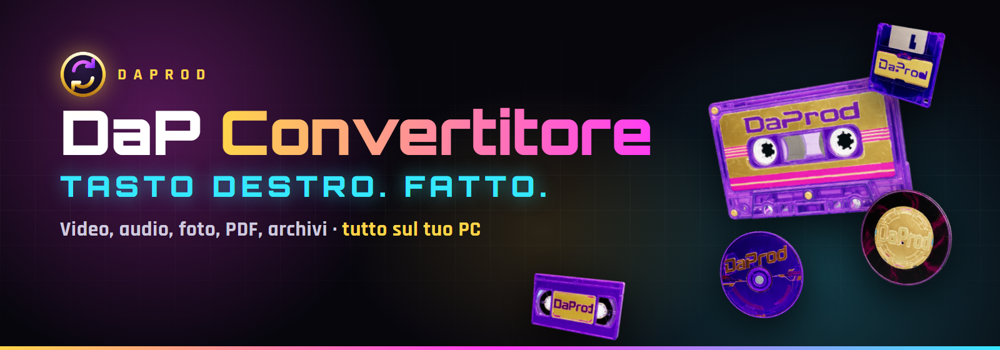
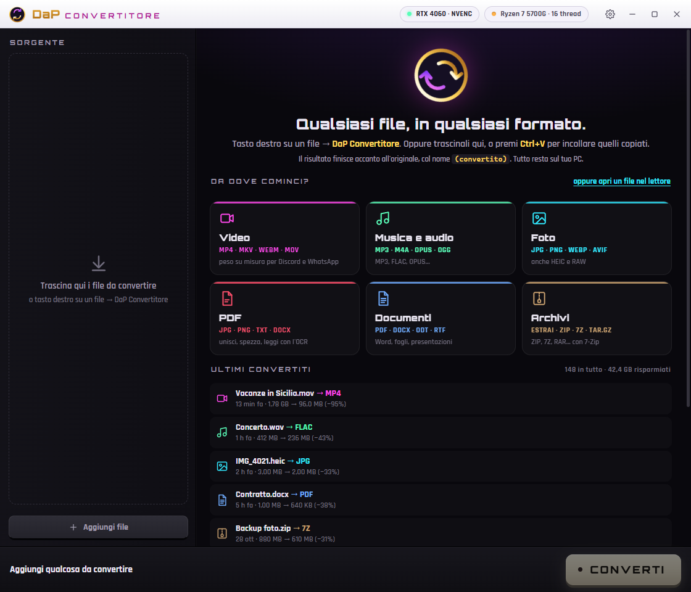
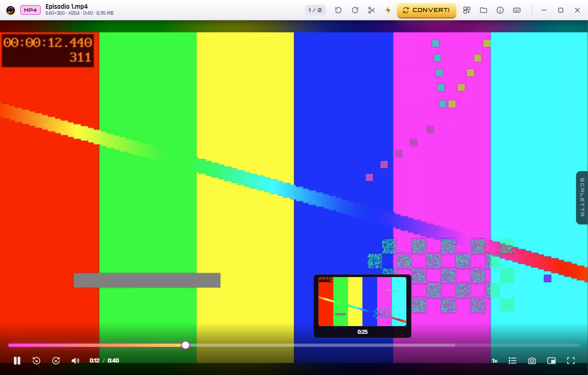
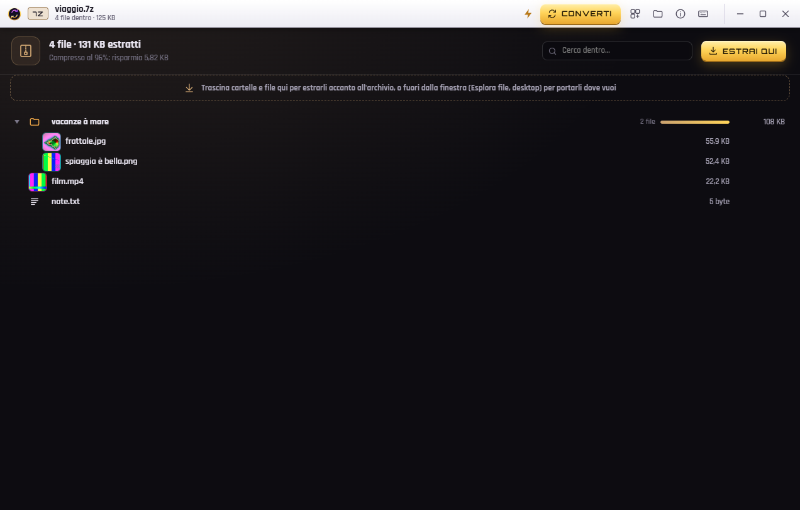
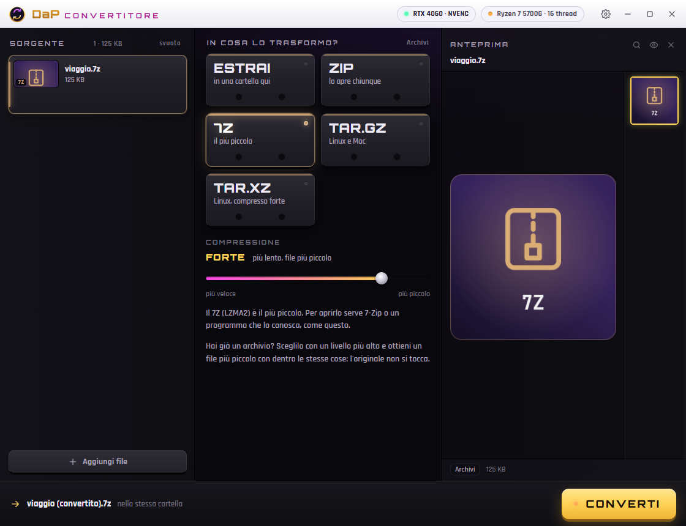
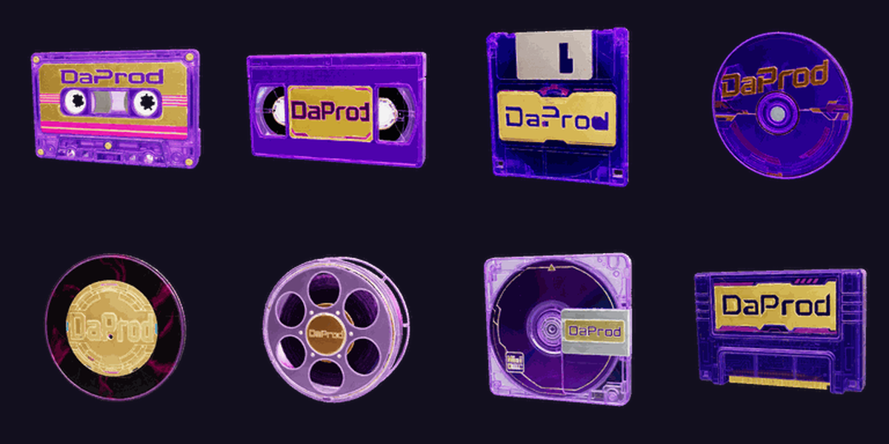

 

 

**DaP Convertitore** è un convertitore di file per Windows. Clicchi con il tasto destro su un file, scegli il formato, e il file nuovo compare accanto all'originale come `nome (convertito)`. Video, audio, foto, PDF, documenti e archivi: tutto lavora sul tuo computer, senza account e senza internet.

 

## Come si presenta

La home: le sei strade (video, audio, foto, PDF, documenti, archivi), gli ultimi file convertiti e lo stato del PC.

Un lettore per tutto. Sui video passi il cursore sulla linea del tempo e vedi il fotogramma di quel punto, fluido come in QuickTime.

Gli archivi si aprono come cartelle, con le miniature di foto e video. Dentro c'è 7-Zip vero.

Per comprimere c'è uno slider, dal «solo archivia» al massimo, e se vuoi la password.

 

## Cosa sa fare

- **Converte quasi tutto.** Video (MP4, MKV, WEBM, GIF…), audio (MP3, FLAC, OPUS…), foto (anche HEIC dell'iPhone e RAW), PDF, Word, Excel, PowerPoint, testi, archivi. Con lo **slider del peso** scegli quanto deve pesare il file finale e vedi la stima prima di partire.
- **Usa la scheda video.** Con una NVIDIA i video si fanno con NVENC, anche in AV1, molto più in fretta.
- **Il lettore.** Foto, video, musica, PDF, testi e codice si aprono con un doppio clic, con anteprima, scaletta, ricerca e le modifiche semplici (girare e ritoccare le foto).
- **Gli archivi.** Apre 7Z, ZIP, RAR, TAR; crea 7Z e ZIP con la password; trascini fuori solo le voci che ti servono.
- **Il tasto destro giusto.** Nel menu nuovo di Windows 11 e in quello classico. Il pulsante **Aggiusta tutto** sistema il menu e le app predefinite, senza giri strani nelle impostazioni.
- **Si aggiorna da solo** e si installa per il tuo utente, senza amministratore.

 

## L'avatar

Un piccolo **oggetto DaProd** che vive sul desktop: una musicassetta che ogni tanto saluta e ogni qualche minuto si trasforma in un VHS, un floppy, un CD, un vinile… **Ci trascini sopra un file** e lo apre, lo converte o lo comprime; la musica parte subito con il suo piccolo player. Con la rotella lo fai grande o piccolo. Sta fermo quando guardi un video o giochi a schermo intero. Si accende da **Impostazioni → Avatar**.

 

## Com'è fatto

Il programma è in due pezzi, e questo lo rende veloce e semplice da mantenere:

- **Il motore** (`src/DaPConvertitore.Motore`) è scritto in **.NET 10**, senza finestre: fa tutto il lavoro. Un solo catalogo dice cosa si converte in cosa, e lo leggono l'interfaccia, il menu del tasto destro e le prove. Sotto ci sono **FFmpeg** per i video e l'audio, **7-Zip** per gli archivi e il motore immagini di Windows per le foto.
- **L'interfaccia** (`ui/`) è una pagina in **TypeScript** dentro una finestra **WPF** con **WebView2** (il motore di Edge). È nello stile DaProd: viola notte, oro e magenta, vetro e Orbitron.
- **Il menu di Windows 11** è una piccola libreria in C++ (`menu/`) che mette il programma nel menu del tasto destro nuovo.
- **L'avatar** è fatto di modelli 3D creati con [Meshy](https://www.meshy.ai) e fotografati in animazione: nel programma ci sono solo le immagini, quindi pesa poco e va offline.

### Come viene sviluppato

Ogni versione ha una voce nel [registro delle novità](CHANGELOG.md) e oltre **170 prove automatiche** che convertono file veri. Quando una versione è pronta, una pipeline su GitHub compila, impacchetta con **Velopack** e pubblica la release da sola. Il codice è aperto, con licenza [MIT](LICENSE).

 

## Installare

| | |
| :-: | --- |
| **1** | Premi **Scarica per Windows** in cima a questa pagina. |
| **2** | Apri il file scaricato: si installa da solo. |
| **3** | Tasto destro su un file → **DaP Convertitore**. |

> Windows può dire «Windows ha protetto il PC», perché l'installatore non ha ancora la firma a pagamento. Premi **Ulteriori informazioni → Esegui comunque**.

 

### Un'app DaProd Produzioni

**[Guida completa](docs/GUIDA.md)** · **[Novità](CHANGELOG.md)** · **[Software di terzi](TERZE-PARTI.md)** · **[Discord](https://discord.gg/Njs52aacwq)**

Fatto con cura, in italiano, da DaProd.

