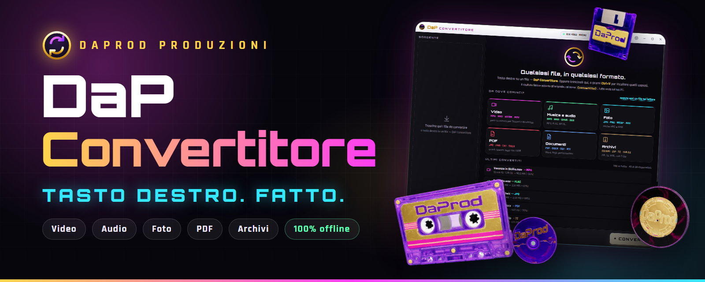
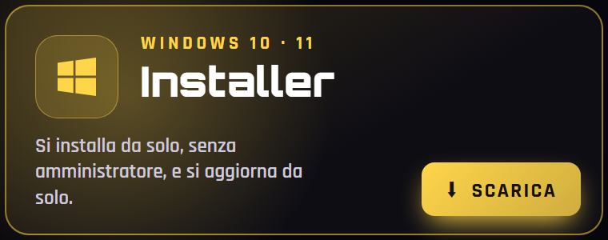
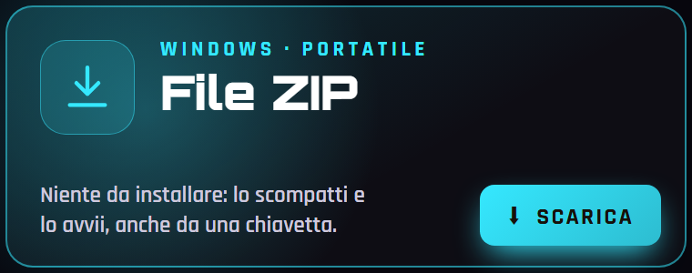
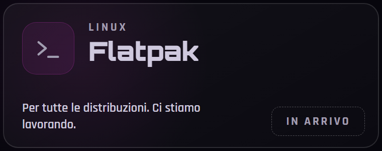
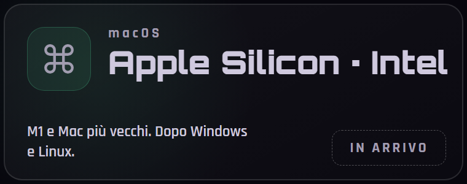
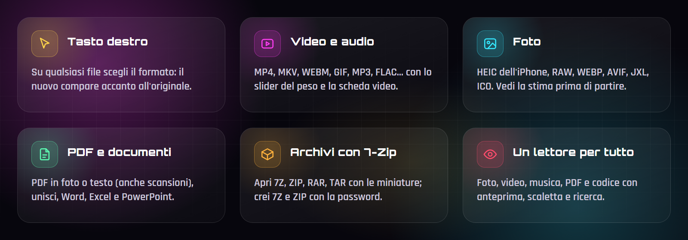
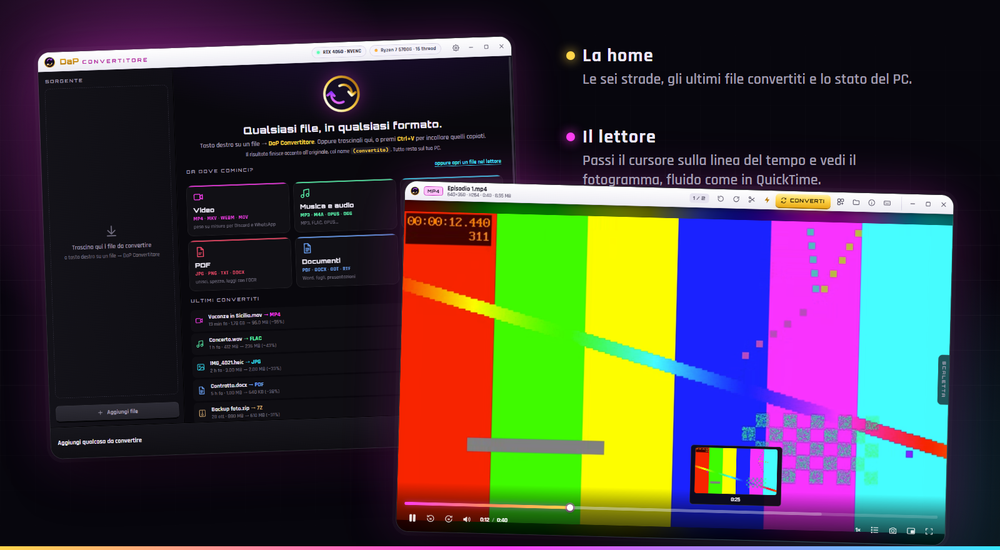
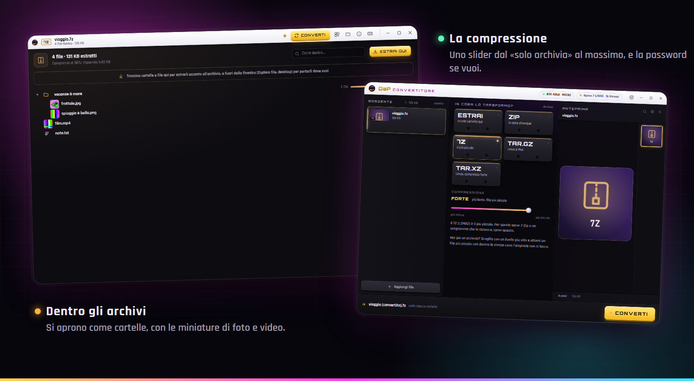
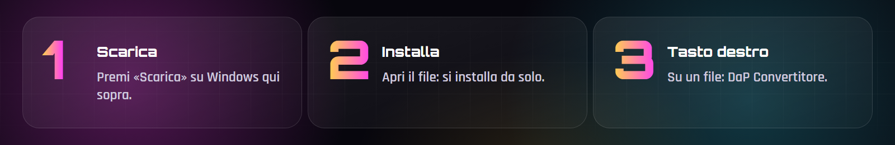

  

  

  <b>Un convertitore per Windows che si usa dal tasto destro.</b> 
  Video, audio, foto, PDF, documenti e archivi: tutto sul tuo PC, senza account e senza internet.

  
  
  
  

 

<h2 align="center">⬇&nbsp; Scarica</h2>

  
  
  
  

I due pulsanti di Windows scaricano il file direttamente, senza passare dalla pagina delle release.

 

<h2 align="center">Cosa sa fare</h2>

  

 

<h2 align="center">Guardalo all'opera</h2>

  

  

 

<h2 align="center">C'è anche un avatar</h2>

  Un piccolo <b>oggetto DaProd</b> vive sul desktop: una musicassetta che ogni tanto saluta e, ogni qualche minuto, 
  si trasforma in un VHS, un floppy, un CD, un vinile… <b>Ci trascini sopra un file</b> e lo apre, lo converte o lo comprime. 
  La musica parte subito, con il suo piccolo player. Con la rotella lo fai grande o piccolo. 
  Si accende da <b>Impostazioni → Avatar</b>.

  

 

<h2 align="center">Come si installa</h2>

  

Windows può dire «Windows ha protetto il PC», perché l'installatore non ha ancora la firma a pagamento. Premi <b>Ulteriori informazioni → Esegui comunque</b>. Si installa per il tuo utente, senza amministratore, e si aggiorna da solo.

 

## Com'è fatto

Due pezzi, ed è per questo che è veloce e semplice da mantenere.

| | |
| --- | --- |
| **Il motore** | Scritto in **.NET 10**, senza finestre: fa tutto il lavoro. Un solo catalogo dice cosa si converte in cosa, e lo leggono l'interfaccia, il menu del tasto destro e le prove. Sotto lavorano **FFmpeg** (video e audio), **7-Zip** (archivi) e il motore immagini di Windows (foto). |
| **L'interfaccia** | Una pagina in **TypeScript** dentro una finestra **WPF** con **WebView2**, il motore di Edge. Stile DaProd: viola notte, oro e magenta, vetro e Orbitron. |
| **Il menu di Windows 11** | Una piccola libreria in C++ mette il programma nel menu nuovo del tasto destro, non solo in «Mostra altre opzioni». |
| **L'avatar** | Modelli 3D creati con [Meshy](https://www.meshy.ai) e fotografati in animazione: nel programma ci sono solo le immagini, quindi pesa poco e va offline. |

### Come viene sviluppato

Ogni versione ha la sua voce nel [registro delle novità](CHANGELOG.md) e passa da **oltre 170 prove automatiche** che convertono file veri. Quando una versione è pronta, una pipeline su GitHub compila, impacchetta con **Velopack** e pubblica la release da sola. Il codice è aperto, con licenza [MIT](LICENSE).

 

  <b><a href="docs/GUIDA.md">Guida completa</a></b> &nbsp;·&nbsp;
  <b><a href="CHANGELOG.md">Novità</a></b> &nbsp;·&nbsp;
  <b><a href="TERZE-PARTI.md">Software di terzi</a></b> &nbsp;·&nbsp;
  <b><a href="https://discord.gg/Njs52aacwq">Discord</a></b>

Un'app <b>DaProd Produzioni</b>, fatta con cura e in italiano.

